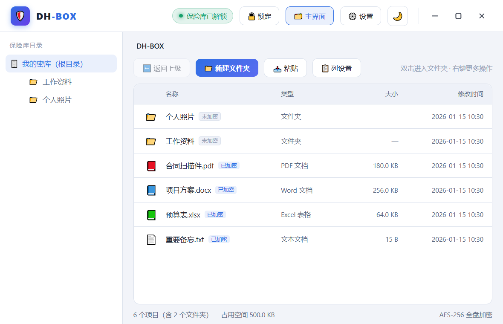
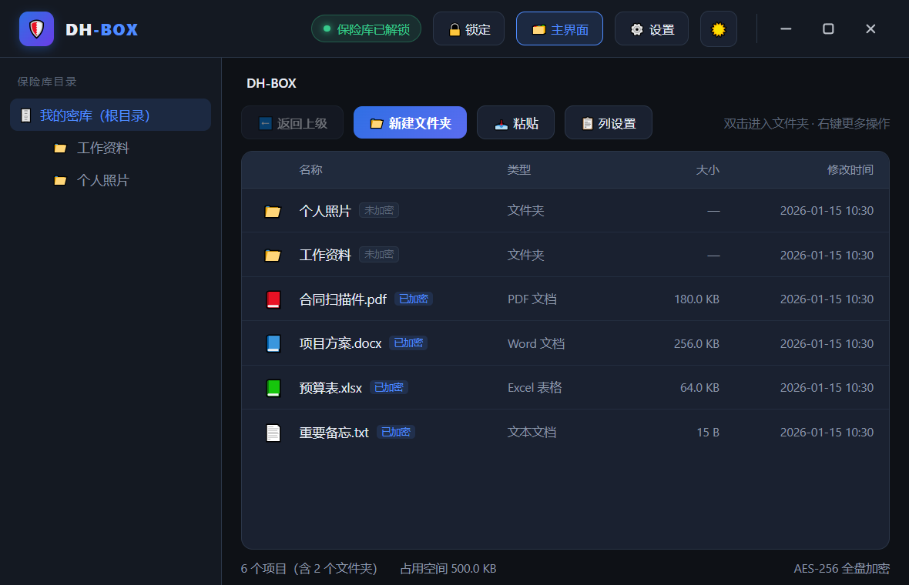
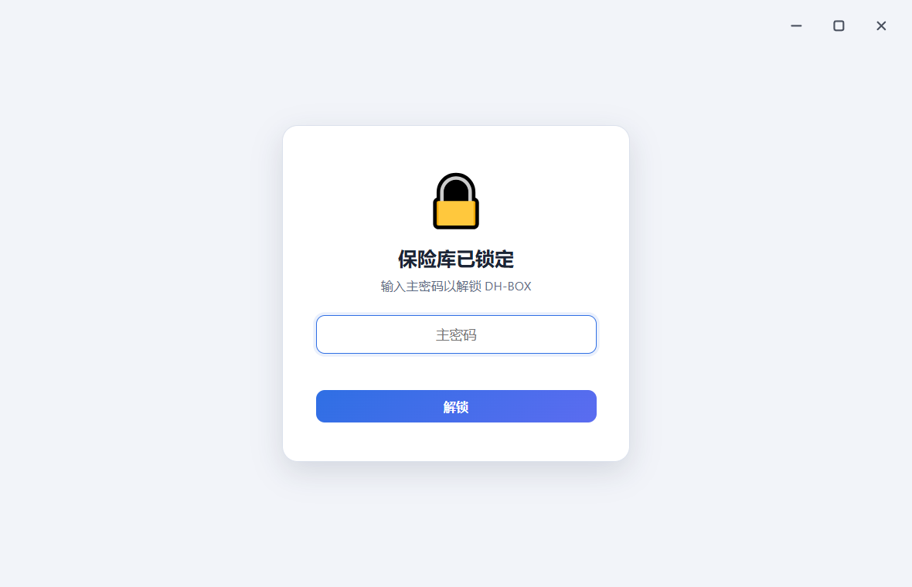
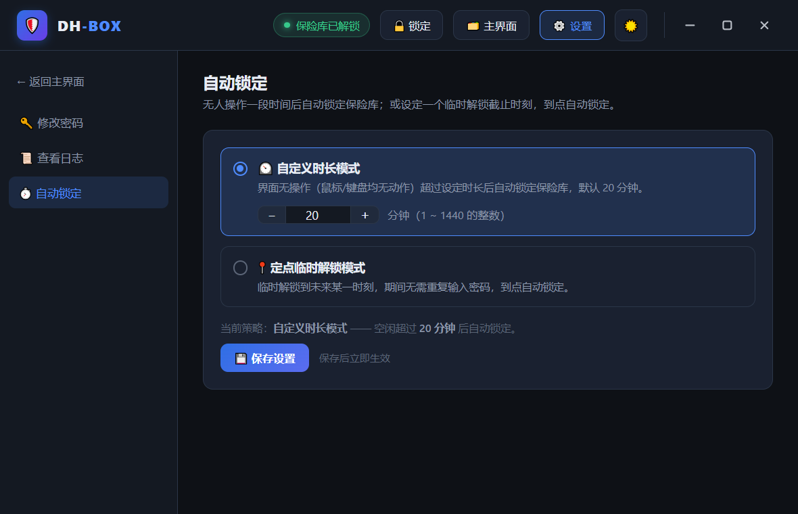

# 🛡️ DH-BOX · 文件加密保险库

> 一个 Windows 本地文件加密保险库：**界面是网页（WebView2 渲染，非控件临摹），加密在 C# 后端**。
> 绿色便携、无需安装、单文件分发；文件内容以 **AES-256** 加密保存在一个容器文件里。



## ✨ 特性

| | 说明 |
| --- | --- |
| 🔐 **真·文件加密** | 文件内容用 **AES-256-CBC + HMAC-SHA256**（Encrypt-then-MAC）加密，篡改即拒；不是"改扩展名"式的假加密 |
| 🔑 **密码派生** | **PBKDF2-HMAC-SHA256**（16 字节随机盐 + **200,000** 次迭代）派生包装密钥；密码与密钥从不落盘 |
| 🧩 **前后端分离** | 界面 = `web/cipherbox-ui.html`（网页），后端 = C# 加密引擎，两者用 WebView2 的 `postMessage` 桥接 |
| 🎨 **现代界面** | 目录树 / 面包屑 / 拖拽窗口 / 深浅主题 / 空闲自动锁定，全部由网页渲染 |
| 📦 **绿色单文件** | 界面已编译进 exe；分发只需 `exe + 3 个 DLL`，数据全部在程序同目录 |
| 🛡️ **安全加固** | 命令白名单、来源白名单、参数白名单、密钥及时清零、明文临时文件用后即删（见下方"安全设计"） |
| 🧪 **可验证** | 自带 **55 项**核心逻辑自动化测试（`run_tests.ps1`），覆盖加解密/改密/篡改拦截/旧容器兼容/阶梯锁定 |

## 📸 界面预览

| 主界面（浅色） | 主界面（深色） |
| --- | --- |
|  |  |

| 保险库已锁定 | 设置 · 自动锁定 |
| --- | --- |
|  |  |

## 🚀 快速开始

### 方式一：直接使用编译好的程序

1. 准备 **4 个文件**放在同一个文件夹里：
   - `DH-BOX.exe`（主程序，界面已内嵌）
   - `Microsoft.Web.WebView2.Core.dll`
   - `Microsoft.Web.WebView2.WinForms.dll`
   - `WebView2Loader.dll`
2. 双击 `DH-BOX.exe` → 首次运行设置主密码 → 保险库 `DH-BOX.vault` 自动创建在程序旁；
3. 之后每次打开：在锁定界面输入主密码解锁即可。

> 数据（`DH-BOX.vault`）/ 设置（`Vault.config`）/ 日志（`vault.log`）都生成在**程序所在文件夹**，整个文件夹拷走 + 记住密码 = 换机继续用。

### 方式二：自行编译（无需安装任何 SDK）

```powershell
# 编译（首次会自动提示下载便携版 Roslyn 编译器，约 21MB）
powershell -ExecutionPolicy Bypass -File .\build.ps1

# 运行核心逻辑测试（55 项）
powershell -ExecutionPolicy Bypass -File .\run_tests.ps1
```

编译产物在 `bin\`：`SecretVault.exe`（可重命名为 `DH-BOX.exe`）+ WebView2 运行库 + `web\`。
编译脚本也会**提示下载 WebView2 SDK**（约 9MB，解压到 `tools\webview2\`，已被 `.gitignore` 排除）。

### 运行环境

- **Windows 10 / 11**
- **Microsoft Edge WebView2 Runtime**（Win10/11 通常随 Edge 自带；缺失时启动会弹提示，可从微软官网下载 Evergreen 安装包）
- 编译环境：.NET Framework 4.8（系统自带）+ 便携版 Roslyn（脚本一键提示）

## 🏗️ 架构

```
┌───────────────────────── DH-BOX.exe（C# 宿主进程）─────────────────────────┐
│  Program.cs      窗口壳 + WebView2 初始化（无边框窗口、内嵌界面、调试模式）    │
│  BridgeHost.cs   postMessage 命令路由（命令白名单 / 来源白名单 / 权限分级）    │
│  VaultFile.cs    条目级加密读写（导入/导出/改名/删除/复制/移动/改密）          │
│  VaultContainer.cs  容器格式 v2（兼容 v1）  │  CryptoUtil.cs  AES-256 + HMAC  │
│        ▲                                                       │            │
│        │ WebMessage：{id,cmd,args} ⇒ {id,ok,data|error}         │            │
│        ▼                                                       ▼            │
│  WebView2 控件 → web/cipherbox-ui.html（界面由网页绘制；界面状态加密存储）     │
└────────────────────────────────────────────────────────────────────────────┘
                                  │
                                  ▼
             DH-BOX.vault（AES-256 密文容器：文件条目 + 界面状态）
```

- **界面状态**（目录树/设置/日志）整体加密保存在容器内的 `.dhbox-state.json` 条目；
- 网页通过 `bridge.post("命令", 参数)` 调用后端（解锁/导入/打开/导出/改密等 20+ 个命令）。

## 🔐 加密设计

```
用户密码 ──PBKDF2-HMAC-SHA256(随机盐16B, 200000 次)──▶ 包装密钥(64B)
主密钥(加密级随机 64B) ──用包装密钥密封──▶ 存入容器头
每个文件 ──AES-256-CBC(随机 IV) + HMAC-SHA256(IV‖密文)──▶ 密封数据
```

- **改密码零重加密**：只重新包装主密钥（约 0.3 秒），文件数据不动；
- **密码验证不试解密**：容器头保存 HMAC 校验器，密码错误立即拒绝；
- **条目级操作**（新增/改名/移动/删除）只重写元数据，未变更文件的密文原样复制；
- 容器写入一律"临时文件 + 原子替换 + `.bak` 备份"；格式 v2（条目含时间戳），**兼容读取 v1 旧容器**。

## 🛡️ 安全设计

| 加固项 | 实现 |
| --- | --- |
| 命令白名单 | 仅分发固定命令集；未知命令一律拒绝并记录安全日志 |
| 来源白名单 | 只接受本地界面站点 `https://dhbox.local` 的 postMessage，其余丢弃 |
| 导航白名单 | 外部导航一律取消；新窗口一律拦截；禁用外部文件拖放 |
| 权限分级 | 数据类命令必须先解锁，锁定时一律拒绝 |
| 参数白名单 | 条目路径逐段校验（禁 `..`/绝对路径/非法字符/系统保留条目；限长限层） |
| 密钥清零 | 锁定/退出时 `Wipe()` 主密钥；数据层派生密钥均有 `finally Wipe` |
| 明文管理 | 打开文件用系统程序所必需的临时副本、状态读写临时文件，均"用后即删"（锁定/退出清理） |
| 不写注册表 | 所有数据都在程序文件夹内 |

**威胁边界（如实说明）**：软件级加密，密码强度是安全底线；打开文件期间明文必然短暂存在于 `%TEMP%\DH-BOX\open\`（系统程序打开所必需）；`vault.log` 是明文日志但不含密码/密钥/文件内容；**忘记密码 = 无法恢复数据**。

## 📂 数据与文件位置

| 内容 | 位置 | 是否加密 |
| --- | --- | --- |
| 文件内容 + 界面状态 | `DH-BOX.vault`（程序旁） | ✅ AES-256 |
| 改密/写入 | 临时文件 + 原子替换 + `.bak` | ✅ 密文 |
| 设置 / 日志 | `Vault.config` / `vault.log` | 明文（不含密码/密钥） |
| 打开文件的临时副本 | `%TEMP%\DH-BOX\open\` | 临时明文，退出/锁定即清理 |

## 🧪 测试

`run_tests.ps1` 内置 **55 项**自动化断言：条目级往返、3MB 大文件、中文文件名、改密码、找回、篡改拦截（HMAC）、旧容器（v1）兼容与升级、日志、阶梯锁定策略等。

```powershell
powershell -ExecutionPolicy Bypass -File .\run_tests.ps1
```

## 📁 目录结构

```
.
├── src/                    C# 源码
│   ├── Program.cs          宿主：窗口 + WebView2 初始化（无边框/内嵌界面/调试截图）
│   ├── BridgeHost.cs       JS↔C# 桥接（命令路由 + 安全校验）
│   ├── CryptoUtil.cs       PBKDF2 / AES-256-CBC / HMAC-SHA256 / 流式密封
│   ├── VaultContainer.cs   容器格式 v2（兼容 v1）
│   ├── VaultFile.cs        条目级 API（导入/导出/改名/删除/复制/移动/改密/找回）
│   └── AppConfig / AppPaths / LockoutPolicy / Logger / Utils
├── web/cipherbox-ui.html   界面（网页，可自行修改）
├── tests/TestVault.cs      核心逻辑测试（55 项）
├── build.ps1               一键编译
├── run_tests.ps1           一键测试
├── tools/
│   ├── dhbox.ico           应用图标
│   └── patch-html.ps1      把前端原型接入后端的补丁脚本
├── docs/screenshots/       界面截图
└── legacy/                 早期 WinForms 界面源码（留档，不参与编译）
```

## ❓ 常见问题

**Q：忘记主密码怎么办？**
无法恢复数据（这就是加密的意义）。密码找回能力保留在底层 API，界面按设计未开放入口。请务必牢记密码并定期备份 `DH-BOX.vault`。

**Q：启动提示缺少 WebView2？**
安装 Microsoft Edge WebView2 Runtime（微软官网 Evergreen 安装包，免费）。Win10/11 通常已随 Edge 自带。

**Q：想修改界面？**
把 `web\cipherbox-ui.html` 放到 exe 旁边（程序会**优先使用外部文件**）；不放则用 exe 内嵌的界面。

**Q：怎么备份/迁移？**
整个程序文件夹拷走即可（`DH-BOX.vault` + 记住密码 = 数据在新机器上可用）。

**Q：安全吗？**
加密算法与实现细节全部公开在本仓库（AES-256 + HMAC-SHA256 + PBKDF2 20 万次），欢迎审计与提交 Issue。

## 📄 许可证

[MIT](LICENSE) © 2026 DH-BOX
